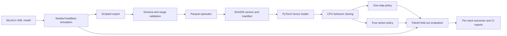

# robot-policy-lab

[](https://github.com/hamza2829/robot-policy-lab/actions/workflows/ci.yml)

A small CPU robot learning pipeline with a demonstration data platform. A two-joint
Cartesian arm pushes a block to a seeded target using MuJoCo contact dynamics.
Behavior cloning compares a one-step policy with a policy that predicts and executes
four actions before observing again. A random policy and scripted expert provide baselines.



## Measured results

<!-- RESULTS:START -->
Results are pending the first successful GitHub Actions run. No measurements are claimed yet.
<!-- RESULTS:END -->

## Run the pipeline

Python 3.11. These commands are for a Linux environment or CI runner. This repository
was developed with verification performed exclusively in GitHub Actions.

```bash
python -m venv .venv
source .venv/bin/activate
pip install torch==2.6.0 --index-url https://download.pytorch.org/whl/cpu
pip install -e '.[dev]'

DATASET=$(robot-policy-lab generate-data --output data --episodes 128)
robot-policy-lab validate-data "$DATASET"
robot-policy-lab train "$DATASET" --output runs/one.pt --chunk-size 1 --epochs 50
robot-policy-lab train "$DATASET" --output runs/chunk.pt --chunk-size 4 --epochs 50
robot-policy-lab evaluate --one-step runs/one.pt --chunked runs/chunk.pt \
  --episodes 128 --start-seed 10000 --output runs/evaluation.json

ruff check .
pytest --cov --cov-report=term-missing
```

Each command supports `--help`. `generate-data` prints the content-addressed dataset
directory; failures are excluded with seed and reason in its manifest. Validation exits
with code 2 and a readable reason on broken data. `train` writes a checkpoint and JSON
loss history. `evaluate` writes every episode's seed, success, step count, final error,
and failure category. Evaluation rejects seeds used in training or validation.

Use **Actions > Robot policy CI > Run workflow** for a complete remote run. The CI
benchmark uses 128 generated episodes, 50 epochs per learned policy, and 128 evaluation
episodes per policy. Jobs have bounded timeouts and use one CPU thread for PyTorch.
No renderer, GPU, display server, or MuJoCo viewer is initialized.

```bash
docker build -t robot-policy-lab .
docker run --rm -v "$PWD/data:/data" robot-policy-lab generate-data --output /data
```

## Task and learning protocol

The XML defines two actuated prismatic arm joints, a spherical pusher, and a block
with two passive planar slide joints. MuJoCo integrates actuator forces and contact.
The expert and policies only supply normalized joint velocity commands; they never
assign the block position during a rollout. One control step is 20 physics steps
at 0.0025 seconds each. Episodes last at most 120 control steps. Success requires
block distance below 0.025 m and block speed below 0.05 m/s for three consecutive steps.

Reset seeds choose block x in [-0.10, -0.03] m, block y in [-0.08, 0.08] m,
target x in [0.17, 0.27] m, and target y within 0.02 m of block y. The pusher starts
roughly 0.09 m behind the block with small seeded position noise. This deliberately
restricts the task to mostly forward pushing.
The expert centers on the rear face and regulates forward motion. Lateral target
offsets are already within the success radius, so this task does not require
general two-dimensional block placement.

Both policies use the same two-layer, 64-unit MLP, tanh action bounds, normalized
observations, Adam optimizer, and demonstration split. The last layer predicts either
2 or 8 values. An episode-level 80/20 seeded split prevents window leakage. Normalization
uses training data only. The checkpoint with the lowest validation loss is evaluated.
Training uses seed 42; evaluation uses shared seeds 10000 through 10127, separate
from generation seeds 0 through 127. Chunk execution is open loop for all K actions.
The random policy samples each action uniformly from [-1, 1]. The benchmark reports
95% Wilson intervals to show finite evaluation uncertainty.

## Dataset contract

One Parquet file contains one complete successful demonstration. All columns are
non-nullable; vectors use fixed-size float32 Arrow lists.

| Column | Arrow type | Meaning |
| :--- | :--- | :--- |
| episode_id | int64 | Nonnegative episode identity |
| seed | int64 | Nonnegative reset seed |
| timestep | int32 | Contiguous index starting at zero |
| observation | float32[12] | State before the action |
| action | float32[2] | Normalized joint velocities in [-1, 1] |
| next_observation | float32[12] | State after the action |
| success | bool | True on the successful final row only |
| terminated | bool | True on the final row only |

Observation order: arm xy, block xy, target xy, block minus arm xy, target minus
block xy, arm velocity xy. Validation checks exact schema, nulls including nested
nulls, finite values, position/relative position bounds of 0.7 m, velocity bounds of
2 m/s, action bounds, relative-coordinate consistency, constant target, transition
continuity, episode identity, contiguous time, terminal flags, and terminal distance.
This catches structural and range errors; it does not re-simulate arbitrary uploaded episodes.

Semantic episode hashes use canonical JSON of validated typed rows and schema version.
Dataset versions hash the sorted list of episode hashes and schema version, independent
of Parquet encoding and input episode order. The manifest additionally records Parquet
byte hashes, row counts, seeds, rejected episodes, generator version, and XML hash.
Validation checks all hashes, detects untracked Parquet files, and rejects unsafe paths.
Publication uses a staging directory and atomic directory rename. Existing versions
are validated before reuse. The loader returns float32 tensors shaped `[12]`, `[K, 2]`,
and `[K]`; masks exclude padding and windows never span episodes.

## Tests and CI

Pytest covers seeded reset and complete rollout determinism, expert success, action
validation, episode lifecycle, good and broken schemas, nulls and ranges, transition
continuity, hash stability across Parquet encodings, manifest integrity, tensor shapes
and padding masks, train/validation separation, loss reduction, checkpoint reload,
paired evaluation reproducibility, seed leakage rejection, and all four CLI commands.
Coverage includes statements and branches with an 85% minimum. The workflow runs
ruff, tests with JUnit and coverage artifacts, and the short train/evaluate benchmark.
Only after these jobs pass does it publish the measured README and raw JSON reports.

## Limits

Simulation only. This is a small constrained task with privileged exact state observations,
two linear arm joints, planar block motion, no yaw, no vertical motion, and no camera.
The block is mechanically constrained to a plane; the table is visual geometry.
There is no real robot, foundation model, reinforcement learning, vision encoder,
collision avoidance planner, domain randomization, or claim of transfer to hardware.
The expert assumes the pusher starts behind the block. Distribution shifts, harder
approaches, and independent target directions can fail. Behavior cloning can drift
away from demonstrations, and four-step chunks delay feedback. A single training
seed and this narrow evaluation distribution cannot establish general superiority
of action chunking. Failure categories describe rollout outcomes, not proven causes.

Implementation references: [MuJoCo Python API](https://mujoco.readthedocs.io/en/stable/python.html),
[Arrow data types](https://arrow.apache.org/docs/python/data.html),
[Parquet IO](https://arrow.apache.org/docs/python/parquet.html), and
[PyTorch serialization](https://docs.pytorch.org/docs/stable/notes/serialization.html).
